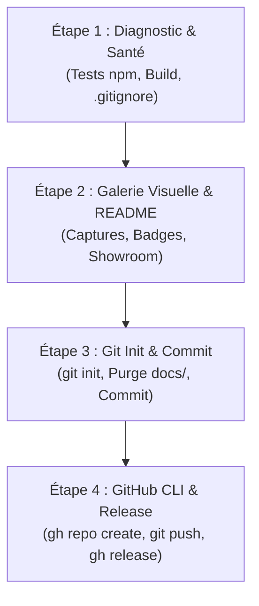

# 🚀 Publication Officielle sur GitHub (/wf-github-publish)

Ce workflow d'action transforme un projet local (extension VS Code, application, bibliothèque ou outil IA) en une **vitrine GitHub professionnelle, attractive et immédiatement distribuable**.

Il garantit le respect de trois piliers fondamentaux :
1. **Zéro Régression** : Validation stricte des tests unitaires et de la compilation.
2. **Showroom Visuel** : Présence de visuels explicites et d'un `README.md` haute fidélité avec badges et guide d'installation.
3. **Packaging & Release** : Publication officielle sur GitHub avec attachement direct des packages binaires (`.vsix`, archives).

---

## 🛡️ Garde-Fous Inflexibles (Guardrails)

- **Déclenchement Explicite Strict** : Ce workflow s'active **UNIQUEMENT** sur saisie utilisateur de `/wf-github-publish`. Interdiction formelle à l'Agent de l'exécuter de sa propre initiative.
- **Sécurité des Données & Zéro Secret** : Ne jamais pousser de secrets, clés d'API, variables d'environnement (`.env`, `.env.*`) ou données personnelles.
- **Validation Interactive Obligatoire** : Toujours demander confirmation à l'utilisateur pour le nom du dépôt, sa visibilité (`--public` ou `--private`) et sa description avant toute création distante.
- **Règle de Confinement N0/N1/N2/N3** : Ce skill est développé localement dans `.agents/skills/wf-github-publish/`, puis auto-promu vers le catalogue global machine (`~/.gemini/config/skills/`) et le NAS maître (`\\Nas1\DD2\IA\Antigravity-Templates\skills\`).

---

## 📋 Déroulement Chronologique (Les 4 Étapes Clés)



---

### Étape 1 : Diagnostic & Contrôle de Santé Préalable

Avant toute opération Git ou réseau, valider la stabilité et la propreté du projet local :

1. **Exécution des tests unitaires** :
   ```bash
   npm test
   ```
   > ⚠️ **En cas d'échec d'un test : ARRÊT IMMÉDIAT**. Ne jamais publier un code instable.

2. **Compilation & Contrôle du Package** :
   - Compiler le code TypeScript / source :
     ```bash
     npm run compile
     ```
   - Vérifier la présence du package distribuable à la racine (ex: `.vsix` pour une extension VS Code). Si absent ou obsolète, lancer la génération du package :
     ```bash
     npm run package
     ```

3. **Audit de propreté `.gitignore`** :
   - Vérifier que `.gitignore` exclut rigoureusement :
     - Les dépendances : `node_modules/`
     - Les dossiers de build : `out/`, `out-test/`, `dist/`
     - Les caches et temporaires : `.vscode-test/`, `.DS_Store`, `Thumbs.db`
     - Les secrets : `.env`, `.env.*`, `*.pem`, `*.key`
     - Les archives lourdes : `*.zip` (si non destinées à être versionnées dans Git)

---

### Étape 2 : Galerie Visuelle & README Vitrine

1. **Vérification / Génération des Captures d'Écran** :
   - Les captures doivent résider dans `media/screenshots/` (ex: `dashboard.png`, `sidebar.png`, `cheatsheet.png`).
   - L'Agent peut exécuter le script utilitaire dédié pour contrôler les images et générer des prévisualisations HTML autonomes :
     ```bash
     node .agents/skills/wf-github-publish/scripts/capture-webviews.js
     ```
   - Si les captures d'écran sont absentes, guider l'utilisateur ou générer les aperçus nécessaires.

2. **Rédaction / Mise à Jour du `README.md` Vitrine** :
   - Utiliser la structure de référence [readme-template.md](references/readme-template.md).
   - **Badges dynamiques Shields.io** : Version active, moteur compatible (ex: VS Code `^1.85.0`), TypeScript, Licence MIT, Statut de production.
   - **Proposition de Valeur** : 3 phrases d'accroche percutantes.
   - **Showroom** : Intégration soignée des captures d'écran.
   - **Architecture & Fonctionnalités** : Présentation claire des 3 niveaux d'orchestration (N1/N2/N3) et des gains de mémoire/tokens.
   - **Guide d'installation express** : Procédure claire en 10 secondes pour installer le binaire `.vsix` via CLI ou via l'interface VS Code.

---

### Étape 3 : Initialisation & Commit Inaugural Atomique

1. **Initialisation Git (si `.git` absent)** :
   ```bash
   git init
   git branch -M main
   ```

2. **Contrôle et Purge du Sas Temporaire (`docs/`)** :
   - Vérifier les fichiers dans `docs/`. Conserver la documentation officielle pérenne.
   - Purger ou archiver les brouillons d'étapes obsolètes.

3. **Indexation et Commit Inaugural Conventionnel** :
   ```bash
   git add .
   git commit -m "feat: initial release vX.Y.Z of [Project Name]"
   ```
   - Afficher l'empreinte du commit créé :
     ```bash
     git log -1 --oneline
     ```

---

### Étape 4 : Création du Dépôt GitHub, Push & Release Officielle

1. **Contrôle d'Authentification GitHub CLI** :
   ```bash
   gh auth status
   ```
   - Identifier le compte connecté (`gh api user --jq .login`).

2. **Validation Interactive OBLIGATOIRE avec l'Utilisateur** :
   - Présenter les paramètres cibles et demander confirmation explicite :
     - **Nom du Dépôt** : (ex: `skills-rules-manager`)
     - **Visibilité** : `--public` ou `--private`
     - **Description** : Résumé clair du projet
     - **Package à attacher** : Chemin du `.vsix` ou du binaire

3. **Création du Dépôt Distant (`gh repo create`)** :
   ```bash
   gh repo create <repo-name> --public --source=. --remote=origin --description "<description>"
   ```

4. **Push de la Branche Principale** :
   ```bash
   git push -u origin main
   ```

5. **Publication de la GitHub Release avec Pièce Jointe Distribuable** :
   - Attacher le package binaire (`.vsix`) à la release officielle :
     ```bash
     gh release create vX.Y.Z <fichier-package.vsix> --title "[Nom du Projet] vX.Y.Z" --notes "<Notes de version détaillées>"
     ```

6. **Synthèse Finale & Liens Partageables** :
   - Fournir à l'utilisateur :
     - 🔗 **Lien du Dépôt** : `https://github.com/<owner>/<repo>`
     - 📦 **Lien de la Release** : `https://github.com/<owner>/<repo>/releases/tag/vX.Y.Z`
     - ⬇️ **Lien de Téléchargement Direct du Package** : `https://github.com/<owner>/<repo>/releases/download/vX.Y.Z/<nom-du-fichier>`

---

## 📚 Ressources Annexes du Skill

- [Modèle de README.md Vitrine](references/readme-template.md)
- [Guide Mémo GitHub CLI](references/gh-cli-guide.md)
- [Script de Contrôle et Prévisualisation Webviews](scripts/capture-webviews.js)
