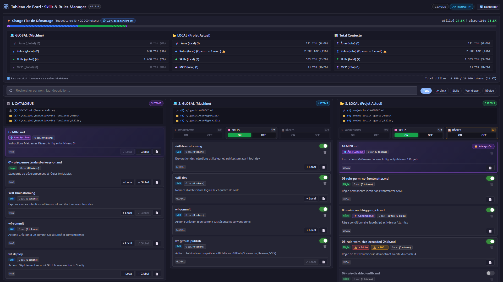
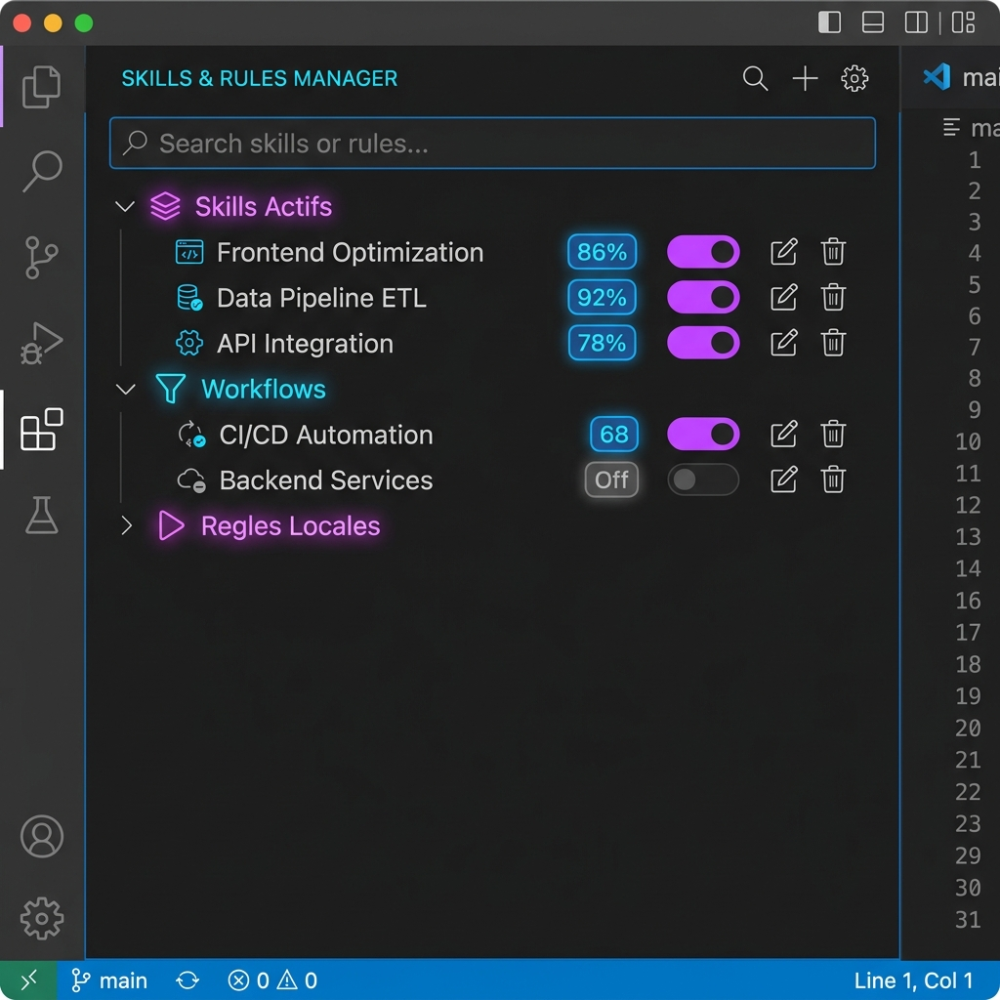
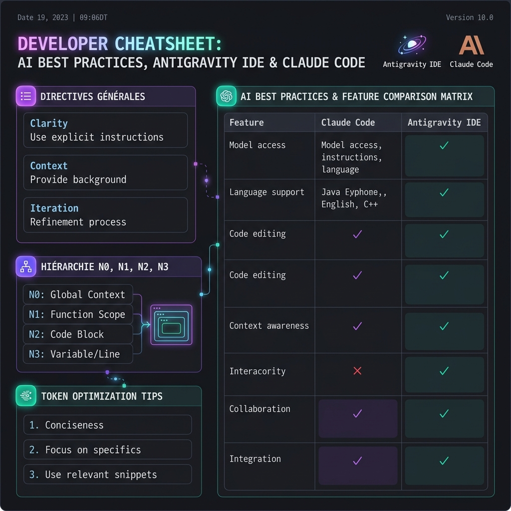
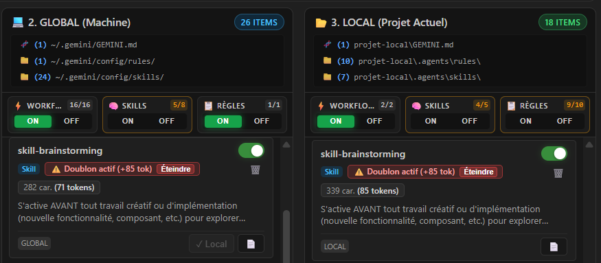

# Skills & Rules Manager (VS Code & Antigravity IDE)

<div align="center">

[](https://github.com/divadparad-gmail/skills-rules-manager/releases)
[](https://code.visualstudio.com/)
[](https://www.typescriptlang.org/)
[](LICENSE)
[](#)

<p align="center">
  <strong>Gestionnaire visuel haute performance pour compétences (skills, workflows) et règles sous Google Antigravity IDE et Claude Code.</strong>
</p>

[ [⬇️ Télécharger la v0.3.11 (.vsix)](https://github.com/divadparad-gmail/skills-rules-manager/releases/latest) ] •
[ [🐛 Signaler un problème](https://github.com/divadparad-gmail/skills-rules-manager/issues) ] •
[ [📖 Guide des Bonnes Pratiques IA](#-guide--bonnes-pratiques-ia-intégré) ]

</div>

---

## 💡 Pourquoi Skills & Rules Manager ?

Lorsqu'on orchestre des agents IA modernes (Google Antigravity, Claude Code), l'accumulation de règles globales, de prompts et de dizaines de compétences entraîne une **saturation de la fenêtre de contexte** (Tier-1 Discovery) dès le premier message.

**Skills & Rules Manager** résout ce défi en offrant :
- 📉 **Jauge de tokens dynamique** : visualisez en temps réel l'empreinte mémoire injectée au boot et désactivez les workflows non pertinents en 1 clic.
- 🏛️ **Vue comparative en 3 colonnes** : cartographiez et synchronisez instantanément vos briques entre le Catalogue NAS maître, votre machine globale et votre projet local.
- 🛡️ **Coach IA Proactif & Résilience NAS** : alertes automatiques sur les règles trop verbeuses (> 200 lignes), les compétences surchargées (> 500 lignes), et tolérance aux pannes réseau SMB.

---

## 📸 Aperçus Visuels (Showroom)

<div align="center">

### 🖥️ Grand Tableau de Bord Comparatif

*Comparaison interactive et synchronisation bidirectionnelle : 🏛️ NAS (Maître) ↔ 💻 Global (Machine) ↔ 📂 Local (Projet).*

<br/>

| 🧭 Vue Latérale & Actions Rapides | 📖 Guide & Bonnes Pratiques IA |
| :---: | :---: |
|  |  |
| *Accès direct, badges d'état et bascules groupées.* | *Tableaux de bord des règles d'or et synthèse Antigravity vs Claude.* |

<br/>

### ⚠️ Détection Intelligente des Doublons (Global vs Local)

*Détection en temps réel des règles et compétences actives en double, calcul précis des tokens gaspillés (+85 tok) et bouton d'action rapide pour éteindre la surcharge en 1 clic.*

</div>

---

## 🚀 Fonctionnalités Majeures

### 1. Cartographie d'Architecture en 3 Niveaux
- **🏛️ 1. Catalogue NAS (Maître Réseau)** : `\\Nas1\DD2\IA\Antigravity-Templates\` (Source centrale de vérité).
- **💻 2. Global (Machine Utilisateur)** : `~/.gemini/config/` et `~/.claude/` (Connecteurs et compétences par défaut).
- **📂 3. Local (Projet Courant)** : `./.agents/` ou `./.claude/` (Règles locales et configurations de projet).

### 2. Économie de Mémoire (Tier-1 Discovery)
- Désactivation instantanée sans perte de données : renommage non destructif (`SKILL.md` ↔ `SKILL.md.disabled`).
- Synchronisation automatique avec `~/.gemini/config/skills.json` (`exclude: [...]`).
- Bascule en 1 clic pour désactiver tous les workflows d'action (`wf-*`) pendant les sessions de développement standard.

### 3. Détection des Doublons & Élimination du Gaspillage (DuplicateService)
- ⚠️ **Alerte Doublon Actif** : Détecte instantanément si une règle ou un skill est actif simultanément au niveau **Global (Machine)** et **Local (Projet)**.
- 📉 **Calcul Précis des Tokens Gaspillés** : Affiche le surcoût mémoire exact injecté en double au démarrage (ex: `⚠️ Doublon actif (+85 tok)`).
- ⚡ **Extinction en 1 Clic** : Bouton d'action directe `Éteindre` sur la carte pour désactiver immédiatement la surcharge sans quitter la vue.

### 4. Coach IA & Alertes de Surcharge
- ⚠️ **Règles > 200 lignes** : alerte sur le risque de dilution d'attention du modèle.
- ⚠️ **Skills > 500 lignes** : recommandation de découpage modulaire vers `references/` ou `scripts/`.
- ⚠️ **Poids physique > 24 Ko** : signalement préventif de saturation de tokens.
- ⚠️ **Outils Claude Code MCP > 2 048 car.** : détection des risques de troncature API.

### 4. Résilience Réseau NAS (SMB)
- Détection asynchrone non-bloquante avec timeout court.
- En cas de déconnexion du NAS, l'interface affiche élégamment l'état `⚠️ NAS Hors Ligne` sans bloquer le travail sur le projet local ou global.

### 5. Découverte & Intégration de Ressources Externes
- **Recherche sémantique** : décrivez en langage naturel ce que vous cherchez (« extraire des tableaux dynamiques derrière une authentification ») ; le moteur déconstruit l'intention, la pile technique visée et les contraintes, puis explique pourquoi chaque résultat correspond. Sans clé Gemini, une analyse lexicale locale prend le relais : la recherche reste utilisable hors ligne.
- **Recherche fédérée multi-registres** : les registres que vous avez configurés sont interrogés en parallèle sous plafond de concurrence, les réponses agrégées, puis dédoublonnées — la source de plus haute priorité l'emporte et les autres sont citées en badge. Un registre lent ou en panne n'interrompt jamais la recherche. Aucun registre n'est interrogé implicitement : tant qu'aucun n'est configuré, la description saisie ne part vers aucun serveur.
- **Trois cibles d'intégration** : chaque fiche porte les actions « Intégrer au projet local », « Intégrer au NAS » et « Intégrer au projet global ». La destination réelle suit l'agent détecté (`.agents/` pour Anti-Gravity, `.claude/` pour Claude Code) et la politique de conflit choisie (demander, écraser ou incrémenter). Avant toute écriture, le manifeste est affiché en lecture seule et une confirmation explicite est demandée.
- **Favoris hors ligne** : les ressources mises en favori conservent leur manifeste en cache local, consultable et déployable sans réseau, avec étiquettes personnelles, export et import de collections.
- **Historique des recherches** : requêtes conservées dans deux portées (projet et machine), éviction du moins récemment utilisé, pastilles de rappel rapide et saisie semi-automatique. Rien ne quitte la machine.

### 6. Détection d'Environnement Adaptative
- **Hôte** : une matrice heuristique à cinq signaux (métadonnées applicatives, `product.json`, chemin du binaire, variables d'environnement, socket locale) attribue un score sur 120 ; au-delà de 60 points, l'extension bascule en mode natif Anti-Gravity. La sonde est bornée à moins de 50 ms et n'interrompt jamais l'amorçage.
- **Agent** : les variables d'environnement et les marqueurs de l'espace de travail départagent Anti-Gravity de Claude Code, et les manifestes sont traduits en conséquence (frontmatter, déclarations d'outils MCP, commandes slash).
- **Dérogation manuelle** : le badge de la barre d'état ouvre un sélecteur de mode, et la commande de diagnostics détaille chaque signal avec son score brut.

### 7. Architecture Modulaire & Médiateur d'Événements
- Les vues sont des composants autonomes : aucune ne détient de référence vers une autre, toutes les interactions passent par un médiateur typé (`ExtensionEventBus`) à enveloppe normalisée.
- Une vue repliée ne perd rien : ses messages sont mis en file circulaire bornée puis rejoués à sa réapparition, après un instantané d'état qui élimine tout affichage périmé.
- Un abonné fautif ne fait jamais tomber l'hôte d'extension : son erreur part en file de lettres mortes et la diffusion se poursuit vers les vues voisines.

---

## ⚡ Installation Express (.vsix)

### Option 1 : En ligne de commande (CLI)
Téléchargez le fichier `skills-rules-manager-0.3.5.vsix` depuis les [Releases GitHub](https://github.com/divadparad-gmail/skills-rules-manager/releases/latest) et exécutez :

```powershell
code --install-extension skills-rules-manager-0.3.5.vsix
```

### Option 2 : Depuis l'interface VS Code / Antigravity IDE
1. Ouvrez l'onglet Extensions (`Ctrl+Shift+X` ou `Cmd+Shift+X`).
2. Cliquez sur l'icône `...` (More Actions en haut à droite du panneau d'extensions).
3. Choisissez **Install from VSIX...** et sélectionnez `skills-rules-manager-0.3.5.vsix`.

---

## ⚙️ Configuration (`settings.json`)

| Paramètre | Type | Valeur par défaut | Description |
| :--- | :--- | :--- | :--- |
| `skillsManager.nasPath` | `string` | `\\\\Nas1\\DD2\\IA\\Antigravity-Templates` | Chemin UNC vers le catalogue maître NAS |
| `skillsManager.globalPath` | `string` | `""` (auto-détecté `~/.gemini/config`) | Emplacement des compétences globales Antigravity |
| `skillsManager.claudeGlobalPath` | `string` | `""` (auto-détecté `~/.claude`) | Emplacement des compétences Claude Code |
| `skillsManager.defaultProjectTool` | `enum` | `"auto-detect"` | Outil cible local (`auto-detect`, `antigravity`, `claude-code`) |
| `skillsManager.debugTiming` | `boolean` | `false` | Mesure et journal de performance des scans et de la tokenisation |
| `antigravity.skills.searchUrls` | `array` | `[]` | Registres interrogés lors de la recherche fédérée (identifiant, nom, URL, priorité, authentification, délai, catégories servies). C'est la seule source de la recherche : aucun registre par défaut n'est interrogé |
| `antigravity.skills.requestTimeoutMs` | `number` | `5000` | Délai d'attente de repli des requêtes de registres (1 000 à 30 000 ms) |
| `antigravity.skills.maxParallelRegistryQueries` | `number` | `5` | Nombre maximal de registres interrogés simultanément |
| `antigravity.skills.nasDirectoryPath` | `string` | `""` | Répertoire NAS d'intégration : chemins UNC, lecteurs mappés, montages POSIX et variables `${env:NOM}` |
| `antigravity.skills.conflictPolicy` | `enum` | `"prompt"` | Conduite à tenir si la ressource existe déjà (`prompt`, `overwrite`, `increment`) |
| `antigravity.search.recentSearchesLimit` | `number` | `10` | Nombre de recherches conservées dans l'historique (jusqu'à 50) |
| `antigravity.environment.hostOverride` | `enum` | `"auto"` | Force l'hôte (`auto`, `antigravity-native`, `vscode-standalone`) |
| `antigravity.environment.overrideMode` | `enum` | `"auto"` | Force l'agent ciblé (`auto`, `antigravity`, `claude-code`) |

> Les identifiants d'accès aux registres privés ne sont jamais écrits dans `settings.json` : ils sont confiés au coffre chiffré du système (`SecretStorage`) et référencés par `secretKeyRef`, qui vaut toujours `antigravity.registry.<id>`.

> Le réglage `antigravity.skills.enableDefaultRegistry` a été supprimé avec le registre par défaut qu'il activait. S'il subsiste dans votre `settings.json`, il est simplement ignoré.

---

## 🔒 Sécurité

La découverte de ressources fait entrer du contenu tiers dans le contexte de votre agent et envoie vos descriptions de recherche à des serveurs. Les garde-fous suivants s'appliquent.

### Registres définis par un dépôt

Un dépôt cloné peut déclarer ses propres registres dans son `.vscode/settings.json`. L'extension les traite comme non fiables :

- **Aucun accès au coffre.** Un registre d'espace de travail ne reçoit jamais de secret ni d'en-tête personnalisé, quelle que soit la valeur de `secretKeyRef`. Il ne peut pas non plus recevoir d'identifiant depuis la vue.
- **Origine non falsifiable.** L'origine d'un registre (utilisateur ou dépôt) est calculée à la lecture de la configuration ; un champ `origin` écrit dans `settings.json` est ignoré.
- **Clé de coffre canonique.** Un registre ne peut désigner que sa propre clé, `antigravity.registry.<id>`. Toute autre valeur, par exemple la clé Gemini, invalide l'entrée.
- **Pas d'usurpation.** Les identifiants en double sont écartés, et un registre de dépôt ne peut pas reprendre l'identifiant d'un de vos registres.
- **Internet public uniquement.** Un registre de dépôt ne peut viser ni votre poste (`localhost`, `127.0.0.0/8`, `0.0.0.0`, `::1`), ni votre réseau local ou d'entreprise (`10/8`, `172.16/12`, `192.168/16`, `169.254/16`, `100.64/10`, `fc00::/7`, `fe80::/10`). Les formes détournées (`http://2130706433`, `[::ffff:127.0.0.1]`…) sont reconnues. Un nom de domaine qui *pointe* vers une adresse interne est arrêté au moment de la connexion, sur l'adresse réellement résolue. Vos propres registres, déclarés dans vos réglages utilisateur, peuvent viser une adresse interne (NAS, registre d'entreprise), et la tolérance HTTP de `localhost` leur reste réservée.
- **Signalement visuel.** La vue Découverte affiche un badge « défini par ce dépôt » sur ces registres.
- **Mode restreint.** Dans un espace de travail non approuvé, VS Code ignore les valeurs de dépôt de `antigravity.skills.searchUrls` et `antigravity.skills.nasDirectoryPath`.

### Installation d'un manifeste distant

Un manifeste installé est lu comme instruction par votre agent. Aucun filtre automatique ne peut garantir qu'il est inoffensif ; la décision vous revient :

- Le manifeste est ouvert dans un onglet en lecture seule, puis une fenêtre « Installer / Annuler » rappelle son nom et son registre d'origine. Rien n'est écrit sans confirmation.
- Une heuristique signale dans cette fenêtre les tournures suspectes : lecture de fichiers ou de secrets du poste, envoi vers une adresse extérieure, consigne cachée à l'utilisateur, instruction prioritaire, commande système. Elle avertit sans bloquer et ne remplace pas votre relecture.
- La provenance (registre, adresse, date d'installation) est consignée dans une clé `source:` du frontmatter, ou en commentaire final si le fichier n'a pas de frontmatter.

### Données transmises

- **Registres configurés** : la description saisie (reformulée par l'analyse d'intention lorsqu'elle est disponible), les catégories recherchées et le nombre de résultats souhaité, en paramètres `q`, `types` et `limit` de l'URL.
- **Gemini**, si une clé est enregistrée : la description à analyser, puis les descriptions des résultats candidats pour le calcul de pertinence. La clé voyage dans l'en-tête `x-goog-api-key`, jamais dans l'URL.

---

## ⌨️ Commandes Disponibles

Accessibles depuis la palette de commandes (`Ctrl+Shift+P` / `Cmd+Shift+P`) :
- `Skills & Rules Manager: Ouvrir le Grand Dashboard`
- `Skills & Rules Manager: Ouvrir le Guide & Bonnes Pratiques IA (Cheat Sheet)`
- `Skills & Rules Manager: Actualiser les Skills et Règles`
- `Skills & Rules Manager: Désactiver tous les Workflows (wf-*)`
- `Skills & Rules Manager: Activer tous les Skills`
- `Skills & Rules Manager: Autoriser l'hôte NAS (UNC) dans la sécurité VS Code`
- `Anti-Gravity: Rechercher une compétence, une règle, un workflow ou un hook` — `Ctrl+Alt+S` / `Cmd+Alt+S`
- `Anti-Gravity: Palette de recherche rapide des compétences` — `Ctrl+Alt+K` / `Cmd+Alt+K`
- `Anti-Gravity: Déployer rapidement une compétence favorite` — `Ctrl+Alt+I` / `Cmd+Alt+I`
- `Anti-Gravity: Basculer le mode de fonctionnement (IDE hôte et agent)` — `Ctrl+Alt+E` / `Cmd+Alt+E`
- `Anti-Gravity: Afficher les diagnostics d'environnement`
- `Anti-Gravity: Configurer la clé d'API Gemini pour la recherche sémantique`

Le panneau latéral s'ouvre par `Ctrl+Shift+G` / `Cmd+Shift+G`. Dans la liste de résultats, les flèches parcourent les fiches et `Alt+L`, `Alt+N`, `Alt+G` déclenchent respectivement l'intégration locale, NAS et globale.

---

## 🧪 Tests & Qualité de Code

Le projet est couvert par une suite de 178 tests unitaires automatisés validant la synchronisation de données, l'intégrité, l'isolation bi-moteur, le Coach IA, le médiateur d'événements, la détection d'environnement, la recherche fédérée, les favoris hors ligne et le pipeline de déploiement :

```bash
npm test          # contrôle syntaxique des vues, compilation et 178 tests
npm run type-check # vérification de types stricte, sans émission
npm run bundle     # paquet de production esbuild (dist/extension.js)
npm run package    # archive .vsix distribuable
```

---

## 📜 Licence

Ce projet est sous licence MIT - voir le fichier [LICENSE](LICENSE) pour plus de détails.
